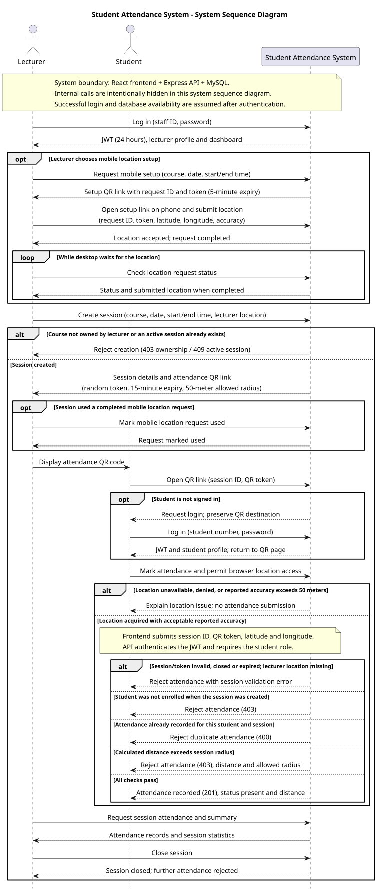
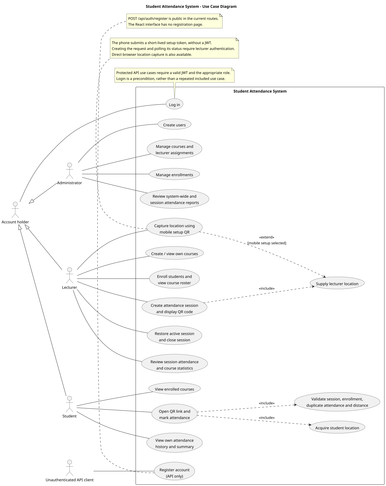
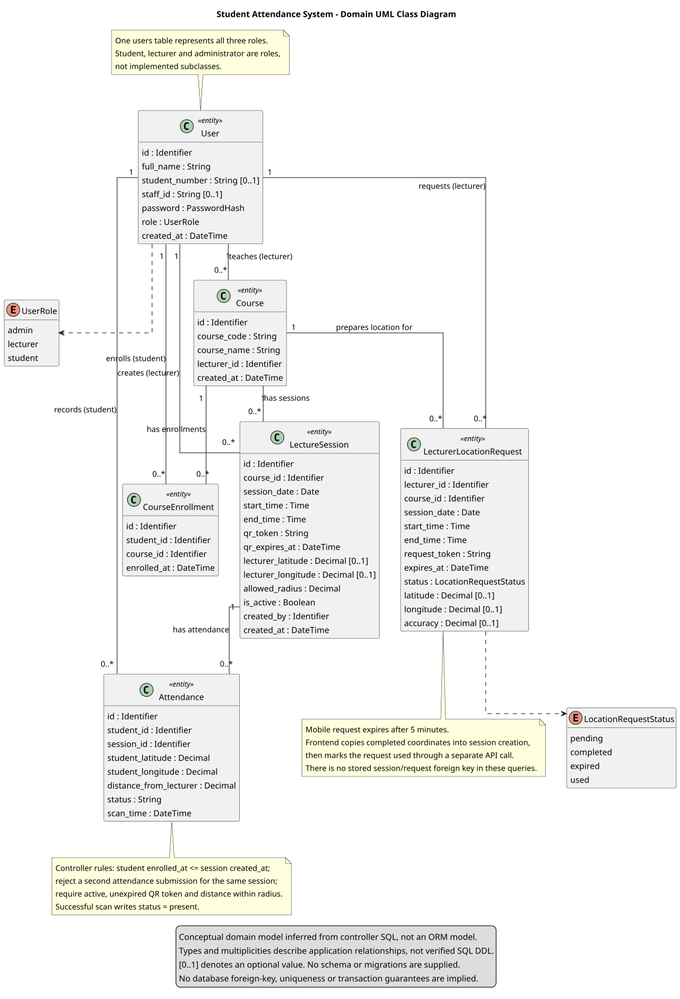

# System diagrams

These UML diagrams document the current React frontend and Express/MySQL backend. Each diagram has an editable PlantUML source file and a rendered SVG that can be viewed directly on GitHub.

## System sequence diagram

Shows the system as a single boundary, with lecturer and student interactions for authentication, optional mobile location setup, session creation, QR attendance, rejection paths, reporting, and closure. Internal HTTP calls and database queries are deliberately hidden; this is a system sequence diagram rather than a component interaction diagram. Successful authentication is assumed after the login steps, and infrastructure failures are omitted.



[PlantUML source](system-sequence.puml)

## Use case diagram

Shows the capabilities available to administrators, lecturers, students, and unauthenticated registration clients. `include` identifies required behavior; `extend` identifies the optional mobile method of providing lecturer location. Protected use cases require authentication and API role checks. The diagram includes the public registration endpoint even though no registration screen exists.



[PlantUML source](use-case.puml)

## UML class diagram

Shows the domain entities, representative fields, role and request-status enumerations, and relationships inferred from controller queries. The backend uses functions and SQL queries rather than JavaScript model classes. Consequently, these are conceptual entity classes, not a claim that equivalent classes, exact SQL types, or database constraints exist. Multiplicities describe intended application relationships; the repository contains no schema or migrations with which to verify their enforcement.



[PlantUML source](class-diagram.puml)

## Implementation references

- [Authentication and registration](../../Backend/controllers/authController.js), [JWT authentication](../../Backend/middleware/authMiddleware.js), and [role middleware](../../Backend/middleware/roleMiddleware.js).
- [Administrative operations](../../Backend/controllers/adminController.js), [courses](../../Backend/controllers/courseController.js), and [enrollments](../../Backend/controllers/enrollmentController.js).
- [Session lifecycle and QR generation](../../Backend/controllers/sessionController.js), [attendance validation and reports](../../Backend/controllers/attendanceController.js), and [mobile location requests](../../Backend/controllers/locationRequestController.js).
- [Lecturer session creation](../../Frontend/src/pages/lecturer/LecturerCourses.jsx), [student location and attendance submission](../../Frontend/src/pages/StudentScan.jsx), and [login destination restoration](../../Frontend/src/pages/Login.jsx).

The frontend rejects student geolocation readings with reported accuracy above 50 meters before submitting attendance. The API separately checks distance against the session's allowed radius (50 meters for newly created sessions). These are distinct checks. Mobile setup tokens expire after 5 minutes, attendance QR tokens after 15 minutes, and login JWTs after 24 hours.

## Regenerate the images

Install Java and Graphviz, and obtain PlantUML from its official distribution. These images were generated with PlantUML **1.2025.10**. From the repository root, run:

```bash
java -Djava.awt.headless=true -jar /path/to/plantuml.jar \
  -charset UTF-8 -tsvg -failfast2 docs/diagrams/*.puml
```

Commit both the source files and regenerated SVG files when updating a diagram. Generating diagrams does not require application credentials or a running database.
